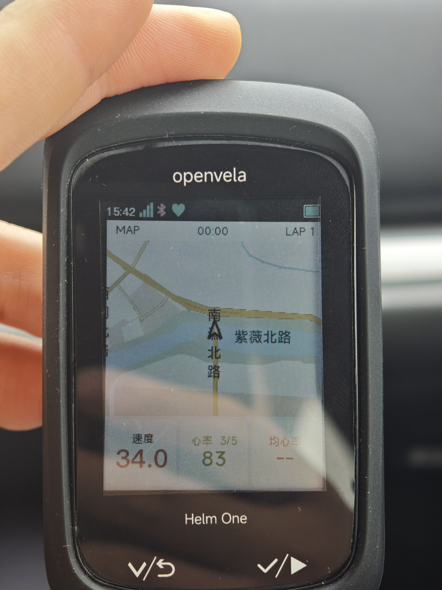
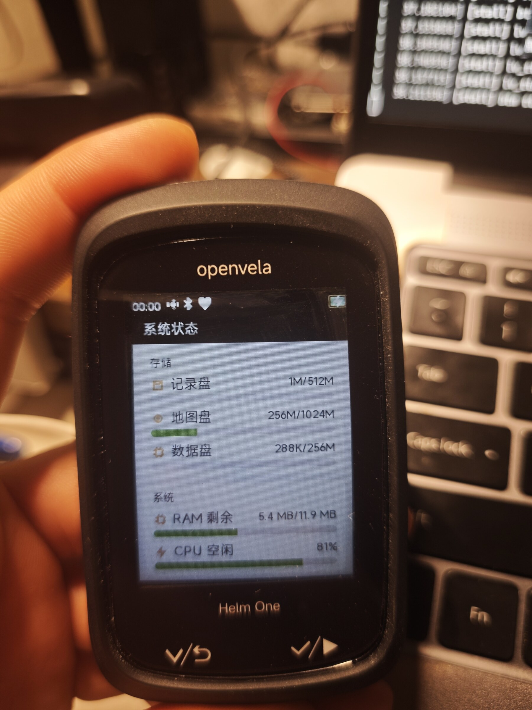
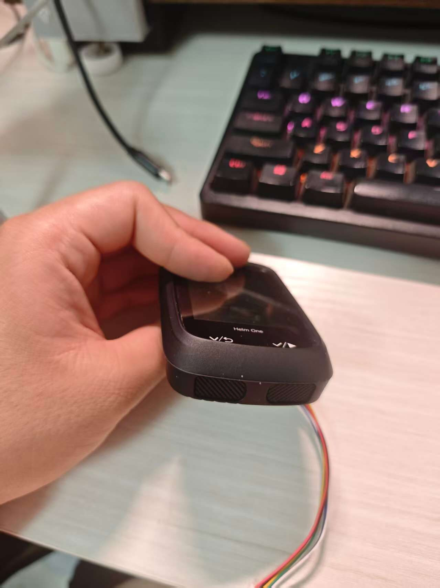
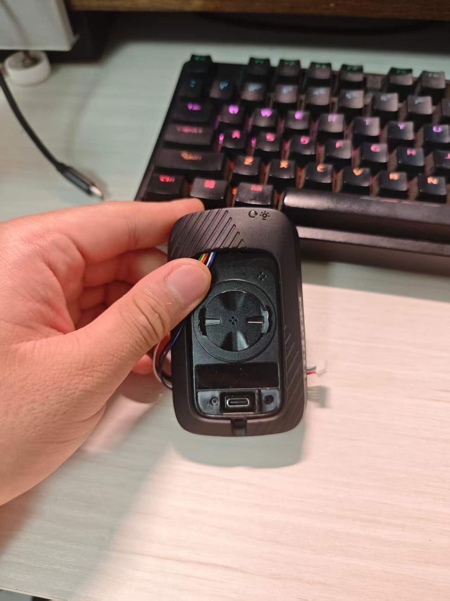
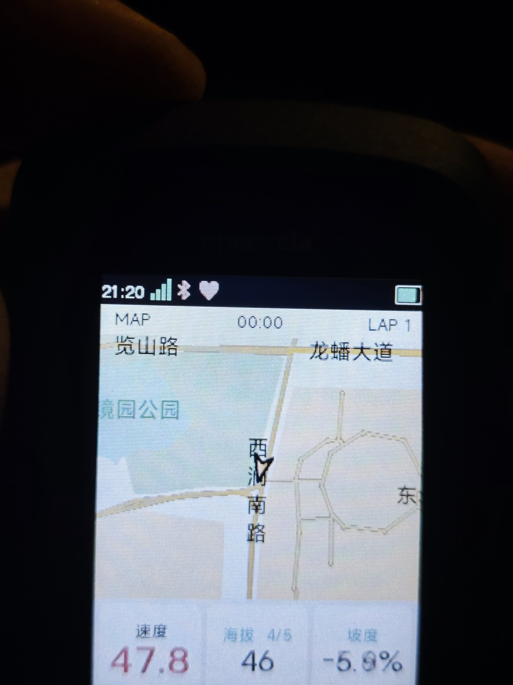
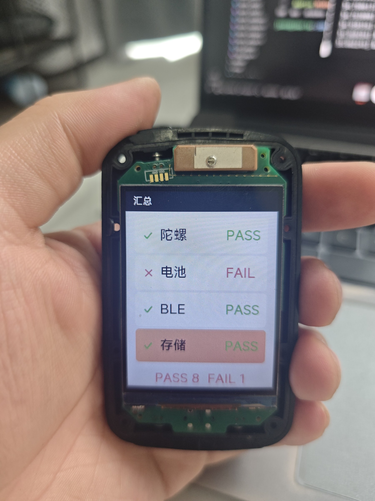

# 低功耗离线全国矢量地图导航自行车码表（Helm One）

> 2026 首届 openvela AI 硬件开发者大赛 · 参赛队伍 **第九个下弦月**（编号 `048`）
> 赛道：**AI 硬件产品创新** + **新硬件平台适配**

---

## 一、作品简介

**Helm One 是一台可以上路的开源骑行码表**：用 openvela + SF32LB52 做成一台完全离线、
无触摸、双实体键的自行车码表，把「全国矢量路网 + 离线路径规划 + GPX 轨迹导航 + 返航」
整套能力塞进一块 2.4 英寸半透半反屏里，全程不需要网络。

**它解决什么问题**（骑行场景的四条真实痛点）：

1. 车把正对太阳——电容屏反光、戴手套点不准、下雨点不准，还得低头伸手，危险；
2. 手机支架耗电、分心，**没有信号就没有地图**；
3. 成品码表价格高、固件闭源、生态锁死；
4. 为了在阳光下看清，普通 IPS 必须把背光拉满，功耗高、画面还发灰。

**核心亮点：**

| 亮点 | 说明 |
| --- | --- |
| **双实体键无触摸交互** | 整机只有 KEY1 / KEY2（另有电源键），覆盖 7 个主页面、28 个菜单屏与完整的记录/导航状态机 |
| **全国离线矢量地图** | 全国路网切成 3 km 网格存于 microSD，按需加载、PSRAM 缓存、软件光栅化，支持 z11–z15 |
| **全国离线路网规划** | 堆式 Dijkstra + 跨网格 portal 拼接（读 `.vpk` 尾部 VPOR + 邻区图 BFS） |
| **半透半反屏 + 低功耗驱动** | MIP 屏 + 重写 LCD / SD / GNSS / 蓝牙 / USB MTP 驱动 |
| **蓝牙双角色（单射频）** | 对手机是 GATT Server，对心率/踏频/功率计是 GATT Client，可同时工作 |
| **手机 App 只做"需要手指和网络"的事** | Flutter App 负责路线规划下发、星历注入、通知转发、OTA |
| **全链路自研开源** | 自研 PCB（EasyEDA 工程）+ 自研外壳 + 固件 + 手机 App + PC 端地图工具链，Apache-2.0 |

**实测关键指标：**

- LittleFS 挂载 **0.474 s**
- SD 顺序读吞吐 **3.1 MB/s**（优化前约 1.0 MB/s）
- 三座城市离线地图产物：**5 925 个分片 / 约 314 MB**
- 自研代码规模（技术报告口径）：约 **25.7 万行**（386 个 C 文件 + 107 个 Dart 文件）

**实机照片**（原图见 [`docs/photos/`](docs/photos/)）：

|  |  |  |
| --- | --- | --- |
| **正面 · 骑行地图页**<br>离线矢量地图 + 速度/心率，双实体键 | **正面 · 系统状态页**<br>记录盘/地图盘/数据盘、RAM 剩余、CPU 空闲 | **侧视 · 机身与底部**<br>机身厚度、底部开孔（测试飞线在插） |

|  |  |  |
| --- | --- | --- |
| **后视 · 卡座与 USB-C**<br>四分之一转车把卡座、USB-C 调试口 | **夜间实拍 · 半透半反屏**<br>览山路/龙蟠大道，47.8 km/h、坡度 −5.9% | **样机 · 工厂自检页**<br>陀螺/BLE/存储 PASS，PASS 8 FAIL 1 |

---

## 二、选题方向

**AI 硬件产品创新 + 新硬件平台适配**（本项目两个方向都做）：

- **AI 硬件产品创新**：从产品定义出发做一台真实可用的骑行码表——无触摸双键交互、离线
  全国地图、低功耗形态，而不是把现成方案换个壳。
- **新硬件平台适配**：在 SiFli **SF32LB52** 上完成全新板级适配，自研 vendor 树
  （`vendor/HelmOne`，本仓 `helm-one/`）与二级 boot（2SFBL），覆盖显示、存储、定位、
  蓝牙、USB 等驱动的重写与调试。

**使用到的 openvela 核心能力（大赛要求至少落地图形 / AI / 多媒体之一）：**

本作品落地的是 **【图形】** —— LVGL 9 骑行界面 + 自绘全国离线矢量地图 + FreeType 矢量
字体渲染；同时使用了 openvela 自有（非 NuttX 内核仓库）的**蓝牙框架**与 **KVDB 框架**：

| openvela 组件 | 仓库归属 | 配置证据 |
| --- | --- | --- |
| LVGL 图形框架 | `apps/graphics/lvgl` | `CONFIG_GRAPHICS_LVGL=y` |
| FreeType 矢量字体 | `external/freetype` | `CONFIG_LV_USE_FREETYPE=y` |
| 蓝牙框架 | `frameworks/connectivity/bluetooth` | `CONFIG_BLUETOOTH_FRAMEWORK=y`、`CONFIG_BLUETOOTH_SERVICE=y` |
| zblue 主机栈 | `external/zblue` | `CONFIG_BLUETOOTH_STACK_LE_ZBLUE=y` |
| KVDB 键值框架 | `frameworks/system/utils/kvdb` | `CONFIG_KVDB=y`、`CONFIG_KVDB_PERSIST_PATH="/mnt/kv/db"` |
| Runtime Skill 规范 | `packages/ai_agent` | `/data/agent/skills/*.md` |

---

## 三、仓库结构

```text
contest2026_048_dijiugexiaxianyue/
├── README.md                     # 本文件：作品说明与总索引
├── LICENSE                       # Apache-2.0（全文）
├── THIRD_PARTY.md                # 第三方组件与数据来源、许可
├── openvela.xml                  # openvela 全量 manifest（repo init 用）
├── contest2026_048_dijiugexiaxianyue.xml   # 本队 manifest（include 上面那份 + linkfile）
│
├── helm-one/                     # ★ 作品主体：完整 vendor 板卡包（sync 后为 vendor/HelmOne/）
│   ├── boards/sf32lb52/helmone/  #   板级：BSP / 驱动 / 服务 / UI / 抽换层 / mkfs 种子
│   ├── chips/sf32lb52/           #   芯片层（Kconfig、外设适配）
│   ├── boot_loader/              #   二级 boot（2SFBL）：SRAM 运行、msh、KV、OVNX 跳转
│   ├── apps/graphics/lvgl/lvgl/  #   自带一份 LVGL 9.5（默认编这份，见下方说明）
│   ├── middleware/               #   蓝牙等中间件适配
│   ├── scripts/                  #   构建/打包：wrap_nuttx_image、gen_flasher_args、build_fs_root…
│   ├── docs/                     #   ★ 全部工程文档（见下节「文档地图」）
│   │   ├── osm/                  #     OSM → 瓦片 → 分片 全流水线（工具 + 手册）
│   │   ├── map/                  #     渲染规范 STYLE.md、运行时 RUNTIME.md、性能实测
│   │   ├── pitch/                #     对上游的改动与补丁（zblue / LVGL / 抽换层）
│   │   ├── tools/                #     上板探针：serial_hub.py、pty_run.py、probe_boot.py
│   │   └── ui/ font/ ble/ debug/ power/ agent/
│   └── ai/skills/vela-helm-one/  #   板级知识 Skill（运行时版见 docs/ai/）
│
├── companion/                    # ★ 手机端与台架工具
│   ├── flutter/                  #   Helm One 伴侣 App（Flutter，111 个 .dart / 3.5 万行）
│   └── esp32/csc_sim/            #   ESP32 台架：模拟 BLE 踏频传感器（CSC）
│
├── hardware/                     # ★ 自研 PCB：EasyEDA Pro 工程 + 说明
│   ├── speedometer.eprj2         #   原理图 + PCB
│   └── README.md
│
├── docs/                         # ★ 提交材料
│   ├── report/                   #   技术报告（.pdf 提交版 + .docx 可编辑版）
│   ├── photos/                   #   实机照片 6 张
│   ├── ai/                       #   自定义 Skill（大赛硬性要求）与 AI 知识沉淀
│   ├── build/                    #   构建/烧录/上板/分区/状态机 说明
│   └── map_pipeline.md           #   离线地图流水线单独说明（数据为何不在仓里）
│
├── logs/                         # AI Coding 日志（JSONL，含脱敏声明与统计）
│
├── board/helmone/                # 板级目录镜像副本（与 helm-one/boards/sf32lb52/helmone 一致）
├── board/contest_board/          # 赛方模板板卡占位
├── app/hello_app/                # 赛方模板 app 占位
└── quickapp/hello_quickapp/      # 赛方模板 QuickApp 占位
```

> **`helm-one/` 与 `board/helmone/` 是同一份板级代码**：前者是 vendor 树里被真正编译的那份
> （`helm-one/` → `vendor/HelmOne/`），后者是赛方「板卡目录」约定下的镜像副本，方便评审直接
> 看板级代码。**改动只改 `helm-one/`**。

> **为什么仓里有两份 LVGL**：openvela 自带 `apps/graphics/lvgl/`；本作品在
> `helm-one/apps/graphics/lvgl/` 下又带了一份 LVGL 9.5 补丁版。编译时只编一份
> （由 `CONFIG_MYVENDOR_LVGL_STACK=y` 决定），详见 [`helm-one/README.md`](helm-one/README.md)
> 与 [`helm-one/docs/pitch/lvgl.md`](helm-one/docs/pitch/lvgl.md)。

### 文档地图（按你想看什么找入口）

| 你想知道 | 看这里 |
| --- | --- |
| **全部工程文档的索引（78 篇，按主题分组）** | [`helm-one/docs/README.md`](helm-one/docs/README.md) ← **找不到就点这里** |
| 这作品怎么编出来、怎么烧进板子 | [`docs/build/reproduce.md`](docs/build/reproduce.md) ← **先看这篇** |
| 板级适配怎么从 0 做一个新板 | [`docs/build/board_guide.md`](docs/build/board_guide.md) |
| 分区、三卷文件系统、溢出处置 | [`docs/build/sd_partition.md`](docs/build/sd_partition.md) |
| 系统状态、按键矩阵、阈值权威口径 | [`docs/build/system_states.md`](docs/build/system_states.md) |
| 离线地图怎么从 OSM 生成 | [`docs/map_pipeline.md`](docs/map_pipeline.md) → [`helm-one/docs/osm/README.md`](helm-one/docs/osm/README.md) |
| 地图怎么渲染、怎么规划路线 | [`helm-one/docs/map/RUNTIME.md`](helm-one/docs/map/RUNTIME.md)、[`helm-one/docs/osm/ROUTING.md`](helm-one/docs/osm/ROUTING.md) |
| 对上游 openvela 改了什么 | [`helm-one/docs/pitch/README.md`](helm-one/docs/pitch/README.md) |
| 引脚与外设接线 | [`helm-one/docs/gpio_pinmux_guide.md`](helm-one/docs/gpio_pinmux_guide.md) |
| 蓝牙（双角色、配对、HCI） | [`helm-one/docs/bluetooth_guide.md`](helm-one/docs/bluetooth_guide.md)、[`helm-one/docs/ble/`](helm-one/docs/ble/) |
| 二级 boot 与启动链 | [`helm-one/docs/boot_2sfbl.md`](helm-one/docs/boot_2sfbl.md)、[`helm-one/docs/nuttx_boot_flow.md`](helm-one/docs/nuttx_boot_flow.md) |
| 死机 / 卡顿怎么查 | [`helm-one/docs/diag.md`](helm-one/docs/diag.md)、[`helm-one/docs/diag_log.md`](helm-one/docs/diag_log.md)、[`helm-one/docs/tools/debug_workflow.md`](helm-one/docs/tools/debug_workflow.md) |
| 手机 App 与双端协议 | [`companion/README.md`](companion/README.md)、[`helm-one/docs/ble/companion_design.md`](helm-one/docs/ble/companion_design.md) |
| 硬件板子 | [`hardware/README.md`](hardware/README.md) |

---

## 四、运行方式

### 1. 拉取工程

```bash
repo init -u https://github.com/jinsc123654/contest2026_048_dijiugexiaxianyue \
  -b dev-ai-contest-2026 -m contest2026_048_dijiugexiaxianyue.xml
repo sync -c -j8
```

同步后，本仓内容位于工作区的 `contest2026_048_dijiugexiaxianyue/`，openvela 全量源码在外层。
（上游合入后也可直接用 `https://github.com/open-vela/contest2026_048_dijiugexiaxianyue`。）

### 2. 作品主体所在的位置

主体代码是**随仓发布的完整 vendor 树** `helm-one/`，清单里的 `linkfile` 会把它挂到工作区的
**`vendor/HelmOne/`** —— 板级 defconfig 的 `CONFIG_ARCH_BOARD_CUSTOM_DIR` 就是按这个路径写死的：

```xml
<project path="contest2026_048_dijiugexiaxianyue" name="contest2026_048_dijiugexiaxianyue">
  …
  <linkfile src="helm-one" dest="vendor/HelmOne"/>
</project>
```

> 不用 `repo`、直接 clone 本仓也可以：把 `helm-one/` 拷成工作区的 `vendor/HelmOne/` 即可
> （等价于上面那条 linkfile）。

### 3. 编译与烧录（固件）

所有命令在 **openvela 工作区根目录**（含 `build.sh` 与 `nuttx/`）执行：

```bash
# 一条命令：编 main + factory 固件 → 生成文件系统镜像 → 打成 SD 整盘 .img
bash vendor/HelmOne/docs/tools/make_sd_2g.sh      # 2 GiB；4 / 8 / 16 GiB 各有一个同名脚本

# 写卡
sudo dd if=boot_loader/bin/helmone_sd_2g.img of=/dev/sdX bs=4M status=progress conv=fsync

# 只编固件（不打整盘镜像）
./build.sh vendor/HelmOne/boards/sf32lb52/helmone/configs/nsh/ --cmake -j8
bash vendor/HelmOne/scripts/wrap_nuttx_image.sh cmake_out/helmone_nsh

# 板载固件烧写：先生成烧录清单，再用 SiFli sftool 烧（本板 BOOT_STORAGE=nand）
python3 vendor/HelmOne/scripts/gen_flasher_args.py
```

更细的从零复现、字节级一致的四个要点、以及上板自检，见
[`docs/build/reproduce.md`](docs/build/reproduce.md)；板级结构与「为什么有一份自己的 LVGL」
见 [`helm-one/README.md`](helm-one/README.md)。

### 4. 编译手机 App

```bash
cd companion/flutter
flutter pub get
./scripts/build.sh apk        # 同步版本号 → flutter build → 自动 adb install
flutter test                  # 22 个测试文件
```

### 5. 生成离线地图（可选，仓内已带样本包）

```bash
bash vendor/HelmOne/docs/osm/make_cities_map.sh
```

完整流程、数据体积、缺失数据怎么补、许可，见 [`docs/map_pipeline.md`](docs/map_pipeline.md)。

### 6. 硬件

| 项 | 型号 |
| --- | --- |
| SoC | SiFli SF32LB52（双核，量产目标 SF32LB527UD6，16 MB PSRAM） |
| 显示 | 2.4 英寸 NV3031A 240×320 RGB565，半透半反（MIP），**无触摸** |
| 定位 | u-blox MAX-M10S + 外置天线 |
| 惯导 | BMI270（IMU）、BMP388（气压计）、MMC5983（磁力计） |
| 存储 | microSD（三卷：KV 256 MiB / LittleFS 512 MiB / FAT 余量） |
| 输入 | KEY1、KEY2（+ 电源键） |
| 软件 | openvela（NuttX 内核）+ LVGL 9 + FreeType |
| PCB | 自研，EasyEDA Pro 工程见 [`hardware/`](hardware/README.md) |

---

## 五、AI Coding 使用说明

本作品在约三个半月内由单人完成约 25.7 万行自研代码，**AI 结对开发**是达成这一规模的关键。

### 在哪些环节与 AI 协作

| 环节 | AI 承担的工作 |
| --- | --- |
| 驱动改写 | SD、LCD、GNSS、蓝牙、USB MTP 的重写与排障 |
| PC 端地图工具链 | OSM 解析、3 km 网格分片打包、路由图与 portal 构建 |
| 双端协议实现 | 固件 Companion 协议 ↔ Flutter App 的同步落地 |
| 需求与方案 | 状态机口径梳理、阈值取舍、文档一致性维护 |
| 调试取证 | 读寄存器 / 外设状态、串口日志定位、机上探针编写 |

### 三个真实案例（AI 定位根因）

1. **SD 控制器死锁**：整卡假死、1 Hz 反复重识别。AI 读控制器状态与官方参考实现后，定位
   到控制器卡在 `CMD_BUSY`，给出**模块级 RCC 复位**方案，问题根治。
2. **LittleFS 挂载 0.474 s**：AI 统计挂载期实际读取扇区数（10 904 → 868），定位到缓存与
   预读参数过大。
3. **蓝牙双角色冲突**：AI 直接读 zblue 源码，定位到 LCPU 在已有连接时禁止设置随机地址并
   返回 `-EACCES`，据此产出上游补丁，实现「连手机的同时扫描传感器」。

### 遇到的问题与解决方式

最大的风险是 AI 会给出**看似合理但未经硬件验证**的改动。为此建立三层验证：

1. **机上探针**——nsh 下 30 余条自测命令，直接读寄存器与外设状态；
2. **串口结构化日志**——关键路径都有可检索的字段；
3. **diag 巡检**——`ble` / `gnss` / `dvfs` / `fs` 四槽健康检查与自动重启。

所有结论以**真机实测**为准。另引入钩子式代码审查在提交前检查改动，并把每次踩坑的原因与
处置写入仓库文档（见 [`helm-one/docs/`](helm-one/docs/)），形成可复用的记忆。

### 沉淀的自定义 Skill（硬性要求）

本团队沉淀了 **3 个** Skill：管产品知识、管开发方法、管独立验收。

**① `vela-helm-one`** —— 面向「openvela + SF32LB52 骑行整机」的板级知识与操作 Skill：

- **运行时路径**：`/data/agent/skills/vela-helm-one.md`（单文件，遵循 `packages/ai_agent` 规范）
- **源文件**：[`docs/ai/vela-helm-one.md`](docs/ai/vela-helm-one.md)
- **内容**：权威值速查（分区/引脚/时钟/阈值/地图参数）、强制约束、故障速查表（现象 → 根因
  → 处置）、机上探针清单
- **触发场景**：板级/驱动开发、地图工程、双端协议修改、稳定性排查

**② `single-conversation-subagent`** —— 单对话两级协作的**开发方法论** Skill
（主对话协调 + 执行子 Agent 返回有界证据；一对话一问的执行模式、有界等待、证据落盘、
独立验收）。开发本作品的板级/驱动/文档工作全程用它跑：

- **独立开源仓**：<https://github.com/jinsc123654/single-conversation-subagent-skill>（v1.3.4）
- **本仓说明**：[`docs/ai/single-conversation-subagent.md`](docs/ai/single-conversation-subagent.md)
- **触发场景**：任务拆分与并行、上下文控制、"只查不改"的排障、改动验收

**③ `codex-review`** —— **独立验收** Skill：让 Codex 以**只读**方式审代码（模型固定
`gpt-6.1-sol`），冻结源码哈希 → 给有界 brief → 逐项 `FIXED/PARTIAL/NOT FIXED` → 出
`ACCEPT/REJECT`，主对话不得替它下结论：

- **本仓说明**：[`docs/ai/codex-review.md`](docs/ai/codex-review.md)（v1.2.0）
- **真实记录**：地图/UI 相关改动**连审 5 轮**（REJECT×3 → ACCEPT×2），另加 `WP-VISUAL` 6 轮；
  原始 brief 与 log 随仓：[`docs/ai/evidence/codex-review/`](docs/ai/evidence/codex-review/)
- **触发场景**：提交前复核、验收前找第三方看一遍、被判定缺陷后的复查

安装方式（①）：

```bash
mkdir -p /data/agent/skills
cp docs/ai/vela-helm-one.md /data/agent/skills/vela-helm-one.md
```

> 说明：openvela 的 `packages/ai_agent` 只扫描 `/data/agent/skills/` 下的**扁平 `.md` 文件**，
> 并把每个文件的**首行标题 + 一段描述**拼进系统提示作为常驻索引，正文由助手 `read_file`
> 按需读取；文件名、大小与 mtime 参与哈希，改动后自动热重载。

### AI 工具链（给 Agent 准备的手）

Skill 给 AI 知识，工具给 AI **能真上板的手**。本项目把「AI 最容易被卡住的三件事」固化
进命令行工具，而不是写进提示词让模型自己小心：

| 工具 | 规模 | 作用 |
| --- | --- | --- |
| **`vela_my_vendor_tools.py`** | 5 940 行 / **19 个子命令** | 构建·烧录·串口监视的**单一入口**：`build-all` 一次跑完 main → factory → 2SFBL → wrap → FS；烧录地址由 `ptab.json` **实时计算**（不手抄），并落 `flasher_args.json` 快照 |
| `build_board.py` | 49 行 | 薄封装入口（`vendor/<树>/build_board.py`），与 `vendor/sifli` 同习惯 |
| `serial_hub.py` | 1 012 行 | **串口租约 + 多路复用**：`release` 让出 TTY → 烧录 → `acquire` 收回，人与 Agent 共享一根串口不互踢 |
| `pty_run.py` | 125 行 | 给子进程分配 pty —— `miniterm` 没有真 tty 会直接 `termios.error(25)`，**Agent 的后台任务靠它才能起 monitor** |
| `probe_boot.py` | 32 行 | 复位脉冲 + 读 3 秒，区分「板子没起来」和「监视脉冲没生效」 |

设计取向一句话：**单一入口、幂等编排、地址不落人手、错误自解释、可被非交互进程驱动**。
详见 [`docs/ai/ai_toolchain.md`](docs/ai/ai_toolchain.md)。

### AI Coding 日志

[`logs/`](logs/README.md) 按赛事约定格式导出（`manifest.json` + 按日期的 JSONL），含会话数、
事件行数、脱敏声明与统计口径。所用工具（ZCode / Cursor）不在官方自动采集列表内，
风险与处置方式在 [`logs/README.md`](logs/README.md) 中如实说明。

---

## 六、注意事项

- 作品遵循 **Apache 2.0** 开源协议（[`LICENSE`](LICENSE)）；第三方组件与地图数据（含
  OpenStreetMap 的 ODbL 署名义务）见 [`THIRD_PARTY.md`](THIRD_PARTY.md)。
- 本作品**不含语音唤醒功能**，因此不涉及「你好，openvela」唤醒词。
- 项目在开发期**未改动 openvela 上游仓库**，板级差异通过
  `helm-one/boards/sf32lb52/helmone/vela_override/` 抽换机制实现（共 16 个上游 `.c` 替换）；
  对上游的改进以补丁形式另行提交（如 zblue `id.c` 的随机地址设置、`scan.c` 空指针保护、
  HCI H4 接收重开的有界重试）。
- `helm-one/docs/` 中的文档来自开发树：正文里的 `my_vendor` 指同一块板卡包在开发期的目录名，
  在本仓对应 `helm-one/`（`vendor/HelmOne/`）；部分日志样例（如
  `my_vendor: fs uses board …`）是固件真实打印的字符串，保留原样。
