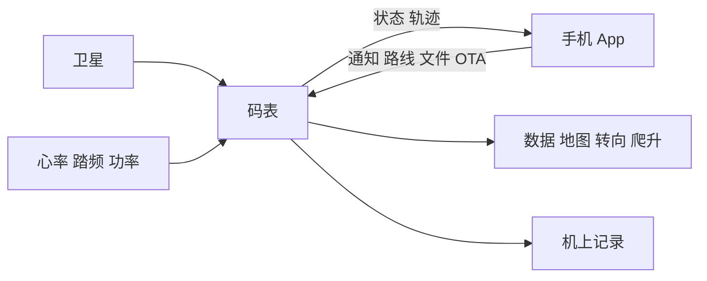
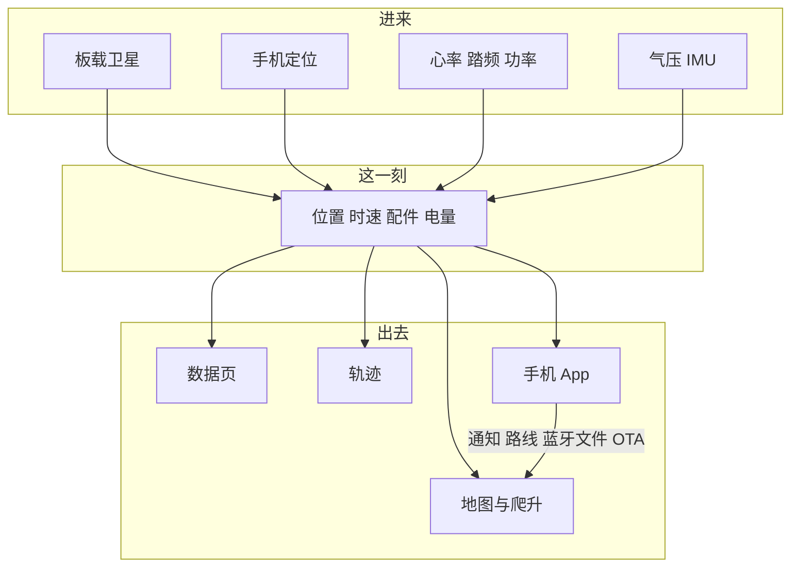

# Helm One

**2026 首届 [openvela AI 硬件开发者大赛](https://openvela.csdn.net/6a496a9e10ee7a33f287fffc.html) 参赛作品**

低功耗骑行码表，配手机 App。系统是小米开源的 [openvela](https://www.openvela.com/#/contest)，地图全国离线，软硬件与 App 全开源。屏是 **半透半反、无触摸**：阳光越强越好看，手套雨天用两颗键，不把电容屏暴露在车把上。

基于官方已有的 **SiFli SF32LB52** 二次开发：自研板、骑行产品，并改了大量驱动，让开发板变成能上路的整机。

| | |
|--|--|
| **低功耗** | 高集成蓝牙 SoC，蓝牙核和应用核分开；半透半反靠日光成像，不必把背光拉满 |
| **全开源** | 系统、板级、骑行应用、手机 App、地图工具链均可读可改，Apache 2.0 |
| **全国离线地图** | 按全国 3 km 网格切块存在 SD 上，骑到哪加载哪，山里没网也有图 |
| **户外半透半反** | **无触摸屏**。日光下越亮越清楚；操作只靠两颗键，手套、汗、雨都不挡 |
| **小米 openvela** | 亿级手表手环同款 AIoT 系统，本作品把图形能力做成码表 |

> 状态、按键、阈值与术语口径见 [system_states.md](system_states.md)；地图细则见 [map/RUNTIME.md](map/RUNTIME.md)；工厂流程见 [factory_firmware.md](factory_firmware.md)。

---

## 给谁用、解决什么

骑车要抬头看路，不该伸手摸一块反光的电容屏，也不该在没信号时变成一块砖。阳光下普通 IPS 要拉满背光还是看不清，戴手套、下雨更点不了。

手机支架耗电、分心、没网就没图；成品码表贵、闭源、生态锁死。Helm One 用 **小米 openvela** 做一台能骑的开源设备：**半透半反无触摸**、低功耗、全国离线图；订路线、点地图放在手机 App 上，车上只看、只按键。

受众是公路和通勤骑行者，以及要在 openvela 上做运动穿戴的开发者。

---

## 车上有什么，骑起来能干什么

| 传感器 | 提供什么 | 用在哪 |
|--------|----------|--------|
| 板载卫星 | 位置、时速、航向、海拔、星数 | 跟车、轨迹、爬升、数据页 |
| 手机定位 | 板载尚未锁定时的位置 | 临时顶上；锁定后仍用板载 |
| 气压计 | 短时起伏 | 与路网高程融合海拔、累计爬升 |
| IMU | 俯仰坡度 | 数据页坡度、水平仪、坡度归零 |
| 心率带 | 心率、配件电量 | 数据页；掉线记住设备回连 |
| 踏频 | 踏频 | 数据页；也可用来判断是否在骑 |
| 功率计 | 功率 | 数据页 |
| 电池 | 电量、充电 | 状态栏和手机 |

没有胸带也能骑。室内锁不住星时，手机还在推位置也可以记；有踏频时停表不必只靠卫星速度。

**看。** 待机显示上次里程。数据页三组轮换：时间 / 里程 / 均速 / 极速，心率 / 踏频 / 功率 / 圈数，海拔 / 坡度 / 爬升 / 下降，各带走势。地图、转向、爬升页大数字时速，底栏约 3 秒轮换两项。顶栏：时钟、星数、手机蓝牙、已配对配件回连、REC / NAV / PAUSE、电量与充电。

**跟。** 全国离线矢量地图跟着当前位置走，叠本次轨迹、导航线和公里标记。

**记。** 码表自己把有效定位写入轨迹，不依赖手机在线；没有有效点则不存文件。结束后可回看缩略轨迹，沿此导航或返航、删除；用 **USB MTP**、蓝牙或 App 拷走、分享。

**导。** 全国离线路网规划，或沿一条 GPX 做轨迹导航；可反向当返航。下一转向有独立页和大图标条；偏航提示并重规划；到达约 45 m。开导航不会自动开始记录。

**爬。** 导航时看前方路线海拔，记录时看近 30 分钟经过海拔；当前位置标在剖面上。海拔用路网高程钉绝对高、气压跟起伏；爬升 3 m 迟滞，停车不计。坡度来自 IMU，可水平归零。

**伴。** 手机 App 下发通知（可按应用筛选并上传图标）、上传 GPX、同步星历并注入模组、骑完分享；电脑走 USB MTP，出门用蓝牙传文件，固件支持 **OTA**。

具体阈值（上屏 / 存储 / 交互）在 [system_states.md](system_states.md) §4。

### 为什么无触摸、用半透半反

码表装在车把上，正对太阳。电容触摸要贴覆盖玻璃，户外反光、戴手套、下雨都点不准，还会逼着人低头伸手。Helm One **不做触摸屏**：

- **半透半反**：日光从正面进来再反射出去，太阳越大对比越强；背光只在树荫和夜里补，不必像手机那样把亮度拉满，也更省电。
- **两颗键**：短按翻页，长按菜单或开始/暂停记录。手套、湿手都能用。
- **界面为这块屏画的**：色域窄，不用整屏死白、不用过暗的饱和色，保证户外仍能读时速和地图。
- **精细操作给 App**：点地图订路线、画 GPX、分享，在手机上完成，再传到车上。码表只负责抬头看和按键确认。

待机三页是待机、数据、地图；骑行或导航时加上转向和爬升。数据页约 3 秒轮换一组四项，地图类页面底栏同样轮换。停住会自动暂停计时，再动继续；自己按暂停则一直停。自动/手动暂停弹窗标题不同。

蓝牙同时连手机和车上的心率/踏频/功率；配对过的配件掉线会回连。

### 交互与体验细节

在双键、无触摸的约束下，把骑行中会碰到的情况逐项处理清楚。按键矩阵与状态迁移见 [system_states.md](system_states.md) §2、§3。

**地图刷新。** 离开地图页时，轨迹点仍在采集；返回后只补画轨迹，不做整图重绘。跟车只平移比屏幕大一圈的底图画布，不解码瓦片；走出边距才分片补边。路名叠在透明层上，不烤进底图。轨迹上标出整公里。插入 USB MTP 时地图让出存储，拔线后继续使用。爬升剖面标出当前位置。满足自动计圈条件时提示进入新的一圈，并清空当前圈的屏幕折线。细则见 [map/RUNTIME.md](map/RUNTIME.md) §6.8、§9。

**导航方式。** 支持全国路网规划、沿 GPX 轨迹导航、将本次记录反向作为返航，以及回放已有轨迹。地图顶条给出下一转向、距离和目的地；偏航约 35 m 后接回路网并提示；可从当前位置就近向后规划；途经点可跳过。常用点、途经点各最多 32 个：码表上按站点顺序点选后长按右键开导；更密请用 GPX。App 绘制 GPX 时，落点吸附道路，空隙沿路网补齐。

**骑行记录。** 菜单列出本机 GPX；点开可见缩略轨迹、里程和时间，可沿此导航、返航或删除。导入目录接受 USB 或蓝牙写入的 GPX。

**定位与传感器。** 板载定位锁定前可使用手机位置，锁定后仍以板载为准。室内持续搜星时不对模组反复断电。静止或卫星质量较差时抑制飞点；短时失锁则保持上一拍时速，避免显示跳变为 0。海拔由路网高程与气压融合；累计爬升 3 m 迟滞，速度过低不计。心率等配件断开后，界面保留上次有效值，不立即清零；可设为回连，并显示配件电量。心率、踏频、功率分别扫描与连接；手机蓝牙与外设蓝牙开关相互独立。

**星历。** App 从网上拉当天广播星历，生成后写入码表并立刻注入模组，无需重启。码表可开自动同步，菜单显示上次/下次时间；关机前保存星历，便于下次更快锁定。

**界面可读性。** 数据页提供时速、心率、踏频、功率、海拔等走势；均速取约 30 秒窗口。配色针对半透半反屏做了提亮，避免户外发灰。提供日光与夜间主题，以及亮度百分比。可开关蜂鸣（开始、暂停、保存、丢弃、到达、偏航、按键各有提示音）、切换公里或英里、设置时区。坡度支持水平放置后归零。设置中可开关 USB 传输。菜单可关机。

**工具箱。** 指南针、气泡水平仪、加速度计、气压高度计，便于停车查看或校正车身姿态。系统状态可查看存储与处理器占用，无需连接电脑。

**通知策略。** 消息在车上弹出，区分来电、短信、日历和应用；可限制为仅来电；最近 **8** 条可在收件箱中查阅。App 可同步手机通知或按应用白名单，可仅在锁屏时推送、或仅在骑行中推送，并可将应用图标传到车上。

### 文件传输与固件升级

车上无触摸屏，大文件不通过点选完成。提供三条路径：

| | 干什么 | 什么时候用 |
|--|--------|------------|
| **USB MTP** | 电脑把码表当成媒体设备，拷地图、轨迹、GPX | 家里、大包；插线时地图让出存储，拔线接着骑 |
| **蓝牙传文件** | App 无线传路线、GPX、小文件、通知图标 | 出门不用带线 |
| **OTA** | App 把新固件写到升级槽，下次开机切换 | 不用拆机、不用专用烧录器 |

USB 采用 **MTP**，在电脑上表现为媒体设备，而不是将整张存储卡挂成普通 U 盘。蓝牙传文件与 MTP 共用车上存储，不可同时占用。量产拷全国地图、写入产品固件包，走工厂固件：产品 MTP 只露出骑行目录，看不到固件槽。

### 手机 App 与码表分工

码表在车上独立工作，**没有触摸屏**：没手机也能记轨迹、离线导航、沿 GPX 导航、把刚记下的轨迹反过来当返航。App 负责需要手指点地图和网络的事。

| | 手机 App | 码表（MCU） |
|--|----------|-------------|
| 通知 | 同步手机消息或按应用白名单；锁屏/骑行条件；上传图标 | 骑行时弹出，抬头能看见；收件箱可回看 |
| 制定路线 | 地图点途经点（吸路），或画/导入 GPX | 用全国离线路网规划，或沿 GPX 走 |
| 上传 | 蓝牙把 GPX 写到车上 import/；也可走 USB MTP | 存进 SD，菜单里选一条就导 |
| 记录 | 同步码表 GPX；累计公里/次数；详情地图 | **机上记录轨迹**，暂停不丢 |
| 导航 | GPX 下发后在车上开导 | 离线导航、轨迹导航、记录返航 |
| 分享 | 分享骑行图、GPX | 文件经蓝牙或 USB MTP 交给手机/电脑 |
| 星历 | 拉广播星历，生成后写入并注入 | 立刻生效；可显示过期与自动同步 |
| 升级 | 检查码表固件 **OTA**；App 自身也可检查更新 | 写入升级槽，开机加载新固件，旧槽可回退 |
| 保活 | 前台服务，避免骑行时蓝牙被系统杀掉 | 双角色：对手机外设、对心率带中心 |

App 三栏：骑行、设备、设置。设备页显示电量、REC、定位来源、配件和剩余存储。设置含中英、缓存、日志导出。连接时校验协议版本，不一致则提示升级。全国底图体积约 GB 级，说明走 USB MTP，不走蓝牙。

导航和记录是两件事：可以只导不记，也可以边导边记。返航是把本次或一条 GPX 反向再导回去。

某一路短暂失效只降级这一路：定位可改用手机，配件数字保持上次有效值，整机卡死才复位。卫星差或静止时压住飞点，轨迹不在楼群里乱画。逐项对照见 [system_states.md](system_states.md) §6。

---

## 工厂模式

产测和量产灌图不能跟骑行界面抢同一套约束。产品固件 MTP 只露出 `/mnt/lfs/mtp`，看不见固件槽，也没有整机外设校验页。因此单独做一份 **工厂固件**：和产品固件各占 SD 上一槽，同一时刻只跑一个，界面仍是两颗键。

上电默认进产品。要进工厂：充电时按住 KEY1+KEY2，或引导阶段连按 F。工厂里 USB 和手机蓝牙强制打开，通知关闭；不加载全国矢量地图和矢量字体，标题用字模「工厂模式」。拷文件走 USB，不走蓝牙文件通道。首页（板卡测试 / 启动槽 / 删除最老固件 / MTP / BLE / 序列号 / 固件版本）与逐页通过的板卡测试清单见 [factory_firmware.md](factory_firmware.md)；状态与按键矩阵见 [system_states.md](system_states.md) §1、§3。

测完才能把「能亮屏」和「能上路」分开：工厂过的是硬件，产品固件过的是骑行。

---

## 在小米 openvela 上做了什么

大赛要求使用 openvela 系统能力，并落地图形、AI、多媒体之一。本作品落地 **图形**：LVGL 骑行界面 + 全国离线矢量地图。

openvela 是小米开源的 AIoT 操作系统，已经在手表、手环等亿级设备上验证过低功耗与图形。Helm One 把同一套系统做成码表，而不是再写一套私有 RTOS。

**二次开发，不是从零贴片。** 官方已有 SF32LB52 与 `vendor_sifli`。本作品在这套芯片和系统上做成整机：半透半反屏、无触摸、接卫星、双键、SD 存全国网格地图和轨迹、USB MTP、蓝牙传文件、OTA。板级和应用在自己的 vendor 里。

**改了很多驱动。** 开发板能亮、能进 shell，和车上能连续跟图、能记轨迹、能同时连手机和心率带，不是一回事。为了低功耗和骑得稳，改过屏刷新、SD 重试、卫星没数据时的重连、蓝牙双角色、USB 拷文件时地图让路、看门狗只在整机真死时复位。

**给社区的建议。** 官方 SF32LB52 + openvela 很适合「低功耗 + 半透半反无触摸 + 双键 + 离线图」的运动设备。户外色板、全国网格按需加载、蓝牙双角色、大文件占用存储时界面让路，值得沉淀成板级约定。

---

## 怎么开发

用 AI Coding 改驱动、做地图与界面和 App 协议，人负责产品判断和真车验证。日志归集到专属仓 `logs/`。码表源码在 `vendor/HelmOne/`，相对官方 `vendor_sifli` 二次开发；伴侣 App 同开源。

---

## 演示建议

App 画或导入一条 GPX 并蓝牙上传 → 码表离线导航（转向页、偏航重规划）→ 长按开始记录 → 数据页走势与地图轨迹、公里标 → 车上通知弹出 → 结束保存 → App 同步并分享，或沿轨迹返航；也可插 USB MTP 拷地图、同步一次星历、演示 OTA。视频不超过 5 分钟。**每个分镜对应哪个状态、该出现哪些元素，见 [system_states.md](system_states.md) §7。**
