# 板端 UI 页面图册（沟通 / 展示 / 追踪用）

> 所有截图来自**板端真 UI 的同一份源码**，由 `lvgl_sim --scene ui`（240×320）
> 在 PC 上渲染，1:1 像素；不需要烧板即可对照。
>
> 命名规则：
> - `P<两位序号>_<中文名>.png`：**当前板端 UI**（老版页面 + 新 DATA 表盘页 +
>   从老版搬回的 X1 仪表台）
> - `S<两位序号>_状态栏_<状态>.png`：状态栏五种状态（整屏），`statusbar/` 里是 5× 放大
> - `legacy/O<两位序号>_老版*`：**回退前的原版固件 UI**（黑条状态栏、旧 X1 仪表台）
>
> 复现（模拟器）：
> ```bash
> cd /home/jinsc/SDK/vela/lvgl_sim
> ./build.sh
> SIM_UI_TOUR_SCRIPT=pages ./build/lvgl_sim --scene ui --headless \
>     --ui-tour <输出目录> --tour-frames 90          # 当前 UI（P/S 系列）
> SIM_UI_TOUR_SCRIPT=night ./build/lvgl_sim --scene ui --headless \
>     --ui-tour <输出目录> --tour-frames 90          # 夜间主题（N 系列）
> ```
> `legacy/` 需先把 `vendor/HelmOne` 的 UI 改动 stash 回 HEAD 再按上面跑
> `SIM_UI_TOUR_SCRIPT=pages_old`。

## 当前板端 UI（P 系列）

| 名字 | 说明 | 到达方式 |
|---|---|---|
| P01_主界面_地图首页 | 开机默认页：地图 + 大时钟/卫星/定位/上次里程卡 +「长按按键 开始骑行」 | 开机 / demo `standby` |
| P02_骑行_表盘页 | **新爬坡页**：270° 时速弧（指示色随档位 绿/黄/橙）+ 速度带（刻度在上、**填充前沿**：上层 14px 填到当前值、2px 墨色前沿，下层 4px 分区底尺）+ 心率五分区（同款填充前沿）+ 四格；底部 = **本程海拔历史**（记录模式：最近 10 分钟，10 s/点，绿/黄/红分段；导航模式：前方剖面）+ **已骑灰域/未骑彩域的交界（2px 前沿）** + **按距离分格**（2px 竖线切等里程格、**只从基线升到折线**，左下角标「X/格」）+ 位置是**倒三角**（橙红，随海拔上下）不足 2 点时只有一句「正在记录海拔…/无海拔数据」 | demo `ride` |
| P02_骑行_表盘页_行驶态 | 20.5 km/h、心率 128 的实际状态：速度带填到 20.5（青），心率带填到 128（灰→青→绿），前沿是 2px 墨线；弧的指示色同步变青 | 模拟器 `SIM_UI_TOUR_SCRIPT=dial`（dial_normal） |
| P02_骑行_表盘页_导航态 | 同上，导航中：底部是**6 km 剖面窗口**（每骑 2 km 重采一次 ⇒ 前方恒有 ≥4 km 可见）；**已骑段填充/脊线都退灰**（三角左侧），右侧按坡度绿/黄/红；位置 = **橙红倒三角**（尖端贴折线，随海拔上下走）；右上「**还剩 X.X km**」= **到终点的剩余里程**（含窗口外还没画出来的部分）；剖面按距离分格，此图 **1 km/格** | demo `ride`（先开 GPX 导航） |
| P02_骑行_表盘页_记录态 | 记录模式底部剖面：**按距离分格** —— 2px 竖线每格一个固定里程、高度只到该列折线（此图窗口 2950 m ⇒ **500 m/格**、5 根、6 格），左下角标「X/格」、右下角「近 10 分钟」。间隔由窗口里程从 100 m / 200 m / 250 m / 500 m / 1 km / 2 km / 5 km 里挑「格数 ≤ 6」的最小值 | 模拟器 `SIM_UI_TOUR_SCRIPT=dialgrid`（`TOUR_ST_ELEV_SEED` 灌满 60 点） |
| P03_骑行_全数字页 | 2×5 十项数字栅格 | demo `data` |
| P04_地图页 | 全屏地图 + 底部速度/时间/里程三卡 | demo `map` |
| P05_骑行_X1仪表台 | **老版 O02 搬进新布局**：左卡大时速 + 时间/爬升/坡度小结，右栏里程/均速/心率/功率（带走势） | demo `dash` |
| P07_菜单_根 | 菜单根页（路线/设备/工具箱/系统…） | 主界面左键长按 |
| P11_开机启动页 | Helm One splash | 每次开机 |
| P12_静止时钟 | 全屏黑白静止钟 | 静止 10 min / 上键双击 |

> **骑行页变更（2026-11-01，用户定）**：
> ① 原独立的**爬坡/海拔页删除**，爬坡信息就是 **P02 表盘页底部的海拔剖面**
> （"现在的 P02 就是新的爬坡页"），老版的海拔页仍在 `legacy/O05` 存档；
> ② **老版 X1 仪表台（O02）搬回新布局 = P05**（"现在我需要新布局有这个"），
> 用 demo 页名 `dash` 可直达；
> ③ **P06 转向页整页删除**（"不需要"，转向信息只走地图横幅），代码/demo 名
> `turn` 一并移除，编号 P06 从此空缺。
> ⇒ 骑行翻页现在是 **4 页**：P02 表盘 → P05 仪表台 → P03 全数字 → P04 地图。

| P01 主界面 | P02 骑行表盘（新爬坡页） | P03 全数字 |
|---|---|---|
| 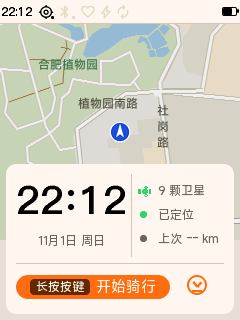 | 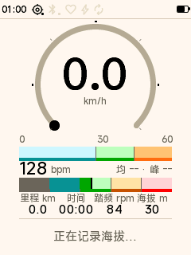 | 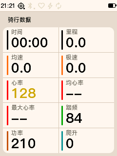 |
| **P04 地图页** | **P05 骑行 X1 仪表台** | **P07 菜单根** |
| 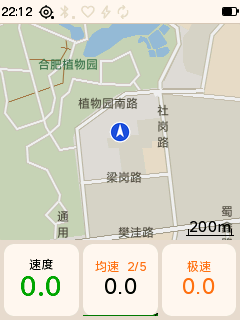 | 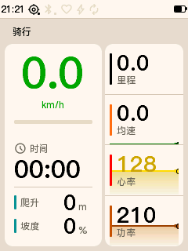 | 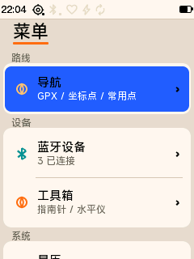 |
| **P11 启动页** | **P12 静止钟** | **P02 导航态（底部剖面）** |
| 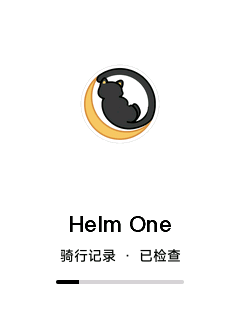 | 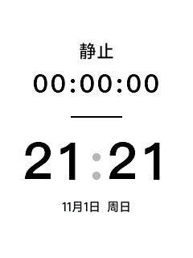 | 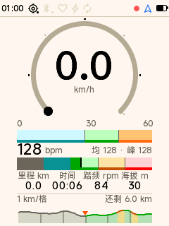 |
| **P02 记录态（剖面按距离分格）** | | |
| 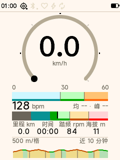 | | |

## 状态栏五态（S 系列）

左簇：时间 / GPS / BLE / 心率 / 功率 / 踏频；右簇：REC / NAV / 电量（无百分比，
右簇整体贴右）。`statusbar/` 里是对应 5× 放大图。

| 名字 | 状态 | 5× |
|---|---|---|
| S01_状态栏_正常 | 记录中（REC 红 8px）+ 导航 + 电量 V2 | 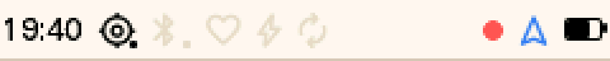 |
| S02_状态栏_暂停 | REC 变灰 |  |
| S03_状态栏_低电 | 电量 <20% 整体转红 | 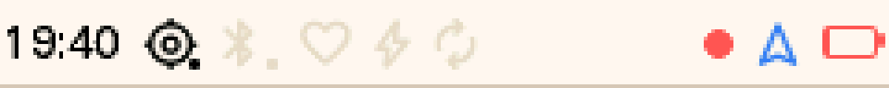 |
| S04_状态栏_外设全断 | 心率/功率/踏频灰、GPS 红 | 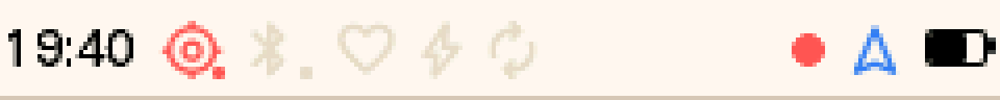 |
| S05_状态栏_未记录 | REC 隐藏 | 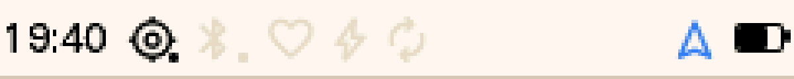 |

补充：`statusbar/电池_V2_5x.png`（从 S01 裁出的电量图标，电池 15×9 + 极 2×4，5×）、
`statusbar/REC_三态_5x.png`（正常红 / 暂停灰 / 未记录隐藏）。

## 上板观感（半透半反面板会洗淡颜色）

模拟器截图是**理想 RGB**；实际面板偏淡：浅填充接近纸白、黑变成环境光下的浅灰、
饱和色整体抬亮。颜色验收先在洗淡预览上看一眼：

```bash
cd vendor/HelmOne/docs/ui
python3 tools/panel_wash.py <截图目录> <输出目录> [k=0.35] [s=0.15]
```

（k = 往反射白混的比例，s = 去饱和比例；这是**近似**，只判断"上板分不分得清"。）

设计约束沿用 `helm_palette.h` 的实测结论：**颜色只承载形状**（色条 / 滑块 / 色带），
文字一律 INK/MUTE。所以：
- 菜单页头 = **22px 大标题（TTF）+ 与文字等宽的 3px 橙色下划线**；不铺色带、不用左轨
  （2026-11-01 用户："菜单的 title 好丑" → 15px 没层级；"这个竖线好丑，放在菜单文字下面
  使用横线都没这么丑" → 左轨改下划线）；
- P02 速度带的分区色条做在**下沿 4px**（2px 洗淡后基本看不见），刻度用 MUTE 字；
- 指示器 = **填充前沿**：带上层 14px 从左端填到当前值（经过的分区深色），右缘压 2px 墨线；
  下层 4px 分区底尺始终完整。剖面同理：已骑整块灰、未骑按坡度上色，交界 2px 墨线。
  洗淡后仍清楚，因为对比靠形状（双臂 + 尖端）与明度，不靠颜色。

## 夜间主题（N 系列，2026-11-01 首测）

`SIM_UI_TOUR_SCRIPT=night` 一趟跑出（只换主题、数据不变）。结论：页面级
配色（纸白/深色表层、状态栏、地图、菜单卡）都正常；P02 的速度/心率带在
夜间是深色底 + 白滑块，可读。菜单页头夜间自动变深棕（NAV_FILL）而不是亮条。

| N01 主界面 | N02 表盘页 | N03 仪表台 |
|---|---|---|
| 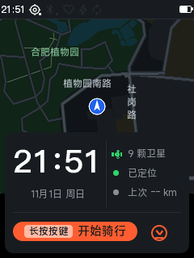 | 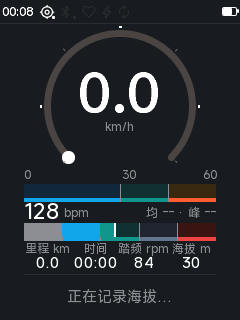 | 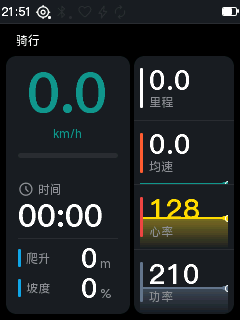 |
| **N04 全数字** | **N05 地图** | **N06 菜单** |
| 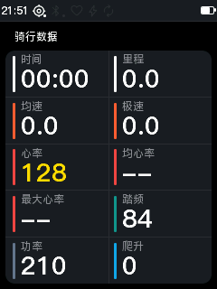 | 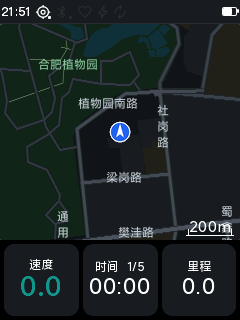 | 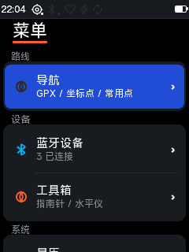 |

## 老版固件 UI（legacy/O 系列）

回退前的原版固件（HEAD）页面，对应"老版电池/黑条状态栏"那一套，供对照与回溯。

| 名字 | 说明 |
|---|---|
| O01_老版主界面_地图首页 | 黑条状态栏 + 地图 + 时钟/卫星卡 |
| O02_老版骑行_X1仪表台 | 旧 DATA：左侧大时速 + 时间/爬升/坡度，右侧里程/均速/心率/功率（**已作为 P05 进入新布局**，此处留作对照） |
| O03_老版全数字页 | 2×5 十项 |
| O04_老版地图页 | 全屏地图 + 三卡 |
| O05_老版爬坡页 | 旧 CLIMB（空态） |
| O06_老版转向页 | 大箭头（空态） |
| O07_老版菜单_根 | 菜单根页 |
| O08_老版启动页 | splash |
| O09_老版静止钟 | 静止钟 |

| O01 | O02 | O03 |
|---|---|---|
| 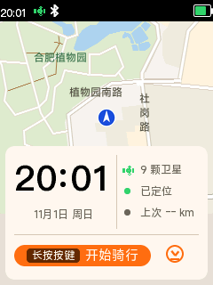 | 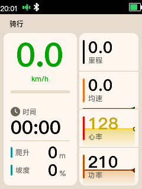 | 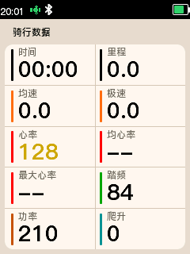 |
| **O04** | **O05** | **O06** |
| 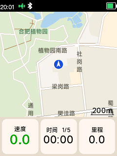 | 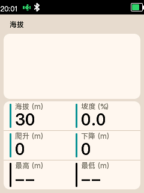 | 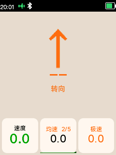 |
| **O07** | **O08** | **O09** |
| 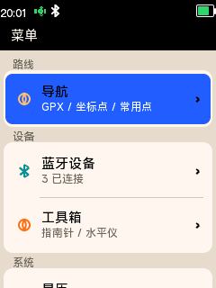 |  | 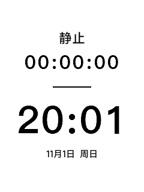 |

## 已回退的设计（仅存档，不在固件里）

Helm 新设计（环形主页 / 三骑行页 / 新键位）曾整体实现后回退，截图与结论留在
主开发树的 `docs/agent/evidence/` 下（**本提交仓只带结论，没收录截图**）：

| 内容 | 子路径 |
| --- | --- |
| 环形主页四模式 | `WP-HELM10/R1/S2/shots/` |
| 表盘 / 数字页 | `WP-HELM10/R1/S3a/shots/` |
| 全屏地图页 | `WP-HELM10/R1/S3b/shots/` |
| 键位矩阵 | `WP-HELM9/R1/C/keys_matrix.md` |

## 设计文档

- [`MAIN_DASHBOARD_LAYOUT.md`](MAIN_DASHBOARD_LAYOUT.md) — 主界面数据面板的
  App 自定义 8 格布局（设计稿，2026-11-02；尚未实现）。
- [`DASHBOARD_WIDGETS_AND_MIGRATION.md`](DASHBOARD_WIDGETS_AND_MIGRATION.md) —
  格子控件目录（CLOCK/VALUE/STATUS/ACTION/BAR/SPARK/PROFILE/ARC/HERO…）、
  各跨度画法、指标目录，以及 P01…P05/状态栏/横幅的迁移映射。

## 更新方式

1. 改完 UI → 重新跑上面的 `pages` 剧本（夜间改动再跑 `night`）；
2. 只复制变化过的页面 PNG 到本目录（保持同名）；
3. 新页面按 `P<序号>_<中文名>.png` 命名并补进本表；
4. 老版页面如需更新，按同样流程用 `pages_old` 重拍并覆盖 `legacy/`。
