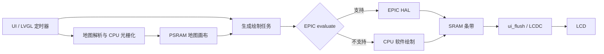

# SF32LB52 UI / EPIC 加速审计

日期：2026-10-15。板卡代码基线：`c6cbd4d7`，构建配置：`cmake_out/helmone_nsh/.config`。

本轮为源码、实际编译参数及既有测量记录核查；未对板卡进行新的计时或 GPU 利用率测量，未修改运行代码。下文区分“已确认机制”与“待上板量化收益”，不把历史测试当成本次固件实测。

## 结论

EPIC 已启用，并非漏开一个 GPU 选项。当前系统把部分像素工作交给 EPIC，但仍存在同步忙等、重复且范围过大的缓存维护、软件绘制覆盖面，以及与 UI 共线程的地图光栅化。GPU 不能替代字体布局、地图解析/投影或 LCD 数据传输。

优先建议：**先加测量 → 修正缓存维护 → 局部编译优化与交互升频 A/B → 静态 UI 缓存/地图切片 → 统一 EPIC 所有权后异步化**。直接切换 LVGL 9.6 或打开绘制线程不保证更快。

## 1. 实际用了哪套代码

| 项目 | 当前证据 |
| --- | --- |
| 板卡 LVGL | `apps/graphics/lvgl/lvgl/lv_version.h:9` 为 9.5.0；已有 `src/draw/sifli/epic/`，含本地 NuttX 适配和部分 9.6 对齐改动，不能简单视作原版 9.5 |
| SiFli SDK 2.4 | `/home/jinsc/SDK/SiFli/SDK/2.4/external/lvgl_v9/lv_version.h` 为 9.2.0，GPU 驱动在 `middleware/lvgl/lv_drivers_v9/sifli/` 和 `rtos/rtthread/bsp/sifli/drivers/drv_epic.c` |
| 官方 LVGL 9.6 | 对照固定 `v9.6.0` tag，而非随时变化的 master；官方将 EPIC 描述为初始集成，尚未在所有场景达到 SiFli 独立驱动的表现 |
| 编译开关 | `CONFIG_MYVENDOR_LVGL_SIFLI_EPIC=y`、`CONFIG_LV_USE_SIFLI_EPIC=y`；SW draw 仍开启，属于正常兜底配置 |
| 执行模型 | `CONFIG_LV_OS_NONE=y`、SW draw unit 数 1；没有开启 EPIC draw thread |
| 优化等级 | compile_commands.json 中 `lv_draw_sifli_epic.c`、`lv_draw_sw.c`、`vmap_render.c` 实际均为 `-O1`；`CONFIG_LV_OPTLEVEL` 为空 |
| 显示 | RGB565、240×320、两个 SRAM 240×160 条带、PARTIAL 模式，已有独立 `ui_flush` 工作线程 |
| 节拍 | LVGL 默认刷新周期 33ms；UI 每轮通常固定 sleep 10ms；系统 tick 10ms，未开启 tickless |

`CONFIG_BSP_USING_EPIC` 未开不能直接推出 GPU 没运行：本板使用 LVGL 自有 EPIC 初始化和 HAL 句柄路径，构建中包含 EPIC draw unit 及 HAL。

## 2. 三套对接方式的关键区别

- **SDK 2.4**：draw unit 经 `drv_epic` 接入 RT-Thread；可见 `_IT` 启动、EPIC IRQ、信号量和连续混合路径。其完成等待有 RTOS 支撑，但是否让 UI 与 GPU 真正重叠，仍取决于绘制线程和依赖关系。
- **官方 9.6**：draw unit → `lv_sifli_epic_cfg` → OSA → HAL；fill/blend 用 `_IT`，回调通知完成；包装仍调用 wait。开启独立 draw thread、等待能阻塞让出 CPU，才有机会与其他可执行任务重叠。不是所有 `_IT` API 都是立即向 LVGL 返回。
- **本板**：`lv_sifli_epic_cfg.c:386,426` 的 NuttX 分支调用同步 `HAL_EPIC_FillStart` / `HAL_EPIC_BlendStartEx`；HAL 内 `EPIC_WaitDone()` 轮询寄存器。draw unit 的同步 dispatch 要等 `_epic_execute_drawing()` 返回后才标记 FINISHED。
- 本地文字路径已经调用 `HAL_EPIC_ContBlendStart/Repeat`，不能把“没有连续字形混合”列为本板问题。

主要本地文件：

- [EPIC 任务准入与调度](../apps/graphics/lvgl/lvgl/src/draw/sifli/epic/lv_draw_sifli_epic.c)
- [NuttX HAL 对接](../apps/graphics/lvgl/lvgl/src/draw/sifli/epic/lv_sifli_epic_cfg.c)
- [OSA](../apps/graphics/lvgl/lvgl/src/draw/sifli/epic/lv_sifli_epic_osa.c)
- [HAL 忙等](../chips/drivers/hal/bf0_hal_epic.c)，`EPIC_WaitDone()`，3541 行附近

## 3. 最值得优先处理：缓存维护范围与重复操作

**机制确认，耗时占比待测。**

当前链路：

1. `_epic_execute_drawing()` 对任务目标区域执行 `lv_draw_buf_flush_cache()`。
2. `lv_nuttx_init()` 在 EPIC 初始化之后调用 `lv_nuttx_cache_init()`，实际覆盖 draw buffer 的 EPIC 缓存回调；因此本板主要走 `src/drivers/nuttx/lv_nuttx_cache.c` 的 NuttX 回调。它直接调用 `up_flush_dcache()`，没有先判断 SRAM / PSRAM 缓存属性；区域换算忽略 x 宽度，处理 `stride × height` 整行范围。EPIC 自身回调具有相同问题，但通常不是最后安装的回调。
3. fill/blend 包装再次调用 `lv_epic_flush_layers_cache()`，分别 clean 输入和输出图层。
4. `lv_epic_setup_layers()` 的背景层是整个 layer buffer，并非当前小矩形。于是小绘制也可能 clean 大背景。
5. 任务末尾又 invalidate 目标范围。

本芯片 CMSIS `system_bf0_ap.c:73` 定义 D-cache 为 **16 KiB**；一条 240×160 RGB565 缓冲是 **76,800 字节（75 KiB）**。NuttX `arm_cache.c` 的 clean/flush 在范围达到 cache 容量时会转成全 cache 操作。即使地址对应无需维护的 SRAM，调用前未过滤也可能付出全缓存维护成本；flush 还会使本来有用的 PSRAM 数据缓存失效。具体触发次数必须加计数，不应推断每个任务都触发。

建议：

- 根据本板 MPU/地址区间判定 cacheability，跳过无需维护的内存，不能只用“指针非空”。
- 按实际读写区域和 cache line 做维护，减少整背景层及重复范围操作。
- CPU→GPU 输入和必要输出边界做 clean；GPU 完成后对 CPU 要读取的输出 invalidate。非对齐首尾 cache line 必须保住邻接脏数据。
- 加 `cache_clean_bytes / invalidate_bytes / all_cache_calls / cache_us` 后做 A/B，不能直接删掉缓存操作，否则会出现旧像素、花屏。

> 2026-10-15 晚更新：过滤已实现（`--cache=filtered/legacy`，`EPIC_CACHE` 计数）并完成上板 A/B，结果见 §10。

证据：[NuttX draw buffer cache](../apps/graphics/lvgl/lvgl/src/drivers/nuttx/lv_nuttx_cache.c)、[EPIC draw buffer cache](../apps/graphics/lvgl/lvgl/src/draw/sifli/epic/lv_draw_buf_sifli_epic.c)、[layer setup](../apps/graphics/lvgl/lvgl/src/draw/sifli/epic/lv_sifli_epic_utils.c)、SDK 根 `nuttx/arch/arm/src/armv8-m/arm_cache.c:808,966`。

## 4. GPU 使用了，CPU 仍在等

本板 NuttX 分支绕过正常异步启动路径，等待中没有有效工作重叠。对于小矩形，任务调度、cache、HAL 配置的成本可能超过像素计算本身；当前准入主要按类型/格式打分，没有按像素面积选择 CPU/GPU 的阈值。

建议分两步：

1. 对 fill、image、label、layer 分别统计任务数、像素数、提交开销和硬件等待耗时，测出小任务阈值。不能用一个阈值覆盖所有格式和透明度。
2. 接通并验证 NuttX IRQ 完成通知，建立统一 EPIC 提交与资源所有权，再考虑 `LV_OS_PTHREAD` + EPIC draw thread。

**不能直接开线程的原因**：地图 `myvendor_epic_blit.c` 与 LVGL 共享同一个硬件句柄，现有设计依赖“都在 UI 线程”和“调用返回即完成”。NuttX `epic_prepare_start()` 走同步专用分支，不能假设开启 OSA 互斥就覆盖了所有地图入口。并发后还必须保证画布、字形、解码缓存以及完成前的 buffer 生命周期。

单核 Cortex-M33 上增加 SW draw unit 不会创造额外算力，反而可能增加锁和缓存争用。先只保留一个 SW 单元进行对照。

## 5. UI 绘制覆盖面：圆角并未全上 GPU

本地 `_epic_evaluate()` 会拒绝：圆角 fill、圆角 border、非 FULL border、带 clip radius/recolor/特殊 blend 的 image，以及不支持的格式/变换组合。line/arc/shadow 等不在其支持分支中。

SDK 2.4 也拒绝圆角 fill/border，LINE/ARC 的 evaluate 分支处于 `#if 0`；因此不是把 SDK 的某个 arc 文件拷来就能完整加速。官方 9.6 放宽了部分 border 准入，但不能只改 evaluate，必须同时核对实际 border 绘制实现。

UI 中有导航横幅圆角、徽章、曲线、图表及透明层，它们会产生 CPU 绘制和额外合成。字体栅格混合可走 EPIC，但 FreeType 字形生成、文本布局和首次资源读取仍在 CPU。

建议优先保持外观：

- 静态圆角背景、装饰和固定曲线缓存成 bitmap；数字/状态区独立更新。
- 页面缓存以数据、主题、尺寸作为失效条件，而不是每次切页重新截图。
- 常用字号与数字字形提前暖缓存，避免首次切页集中加载。
- 曲线仅在数据变化时重绘；不要为“GPU 命中率”把小任务全部强塞给硬件。

已存在的优化：`helm_label_set()` 有文本相等早退；`helm_ui_cb()` 在页面被覆盖时跳过后续绘制、每 500ms 更新；这些不能重复当作新发现。

## 6. 翻页动画已经做过实验，不宜重新走弯路

`helm_shell.c:85` 当前 `HELM_VIEW_ANIM=0`，编译参数未找到覆盖，主数据页是直接切换。文件中保留的 mode 4 两张整屏快照不是当前运行路径。

代码注释中的历史板测：普通位移 176–413ms / 2–3 帧；fade 最差 458–906ms；快照推挤 276–398ms / 6 帧，其中开始前快照约 150–250ms。它们不是此次新测结果，但指出“每次翻页临时截图”会把开销集中在首帧。

另外页面管理器 `gpu_depth` 通过修改对象树 scale/opacity 实现；名称含 GPU 不代表整棵对象树免费变成缓存纹理。每帧仍可能要生成和绘制离屏 layer，最后才交 EPIC 合成。

建议：先让页面的静态部分常驻缓存，按需更新，再恢复位移/缩放动画。240×320 RGB565 一页 150 KiB、两页 300 KiB；需要和 1.5 MiB 瓦片缓存、地图画布、字体等共享 4 MiB PSRAM 的预算，不能盲目给所有页面留整屏图。

## 7. 地图会拖慢整个 UI，EPIC 无法直接替代地图 CPU

`map_page.c:1780` 的 render pump 由 LVGL timer 触发。`vmap_render.c` 的多边形扫描线、道路描边等直接写 canvas；这些不是 LVGL draw task，升级 draw unit 不会自动让它们走 GPU。

`vmap_view.c:2060` 的 8ms 预算只在瓦片之间检查，不能中断一块复杂瓦片。已有历史测量单瓦片可达 15–38ms；因此一块瓦片就足以错过 UI 帧预算。

建议：

- 第一阶段按 feature/扫描线等更小粒度切片，让 UI 定时器可及时返回；先降低最长阻塞，不只看平均帧率。
- 资源读取、解码和投影可逐步搬到工作线程，以不可变结果/完成队列交回 UI；LVGL API 留在 UI 线程。
- 后续如整张地图在 worker 光栅化，需双缓冲或区域所有权；GPU blit 与显示读取同一画布时不能无保护并行。
- 保留已经存在的 EPIC 清屏/搬运及重叠复制 scratch 路径，不要声称地图完全没用 GPU。

历史 [PUMP_PERIOD.md](map/perf/PUMP_PERIOD.md) 已否定简单把 20ms 渲染泵周期改为 10ms 能明显加速；主要工作没有变小，调度间隔也不是唯一瓶颈。

## 8. CPU、节拍和 LCD 的边界

### CPU

实际热点以 `-O1` 编译。建议只对 LVGL SW renderer / vmap / 必要字形路径做 `-O2` A/B，检查镜像体积、栈和绘制一致性；不先全工程 O3，更不对地图几何随意启用 fast-math。

DVFS 有 144/240 MHz 两档，交互 floor 是 144 MHz；地图/启动等 hold 可要求 240 MHz。非地图页面首帧可能还处于低频，需测量。先用 `ctl dvfs 240` 做固定频率对照；若效果明显再做短时交互升频，保留省电策略。

### 调度

33ms 的刷新周期约束常规刷新节奏；每圈固定 sleep 10ms 未使用 handler 返回值安排睡眠，加上 10ms 系统 tick，可能形成额外等待与抖动。但当一轮绘制已经超过 33ms，单改刷新为 16ms 并不能治好卡顿。

### LCD

本板已有双 SRAM 条带 + LCD worker，不能把显示路径误判为全程同步单缓冲。双条带共 150 KiB SRAM，继续扩大有明显代价。

NV3031A 配置 QSPI 24 MHz、RGB565、未接 TE。仅按 4-bit 数据线估算整屏像素传输下界为：

`240 × 320 × 16 / (24,000,000 × 4) = 12.8ms`

这只是理论数据阶段下界，不包含命令、窗口、调度及总线竞争，不是实际 FPS。历史驱动注释记录 36MHz 花屏并已回退，不能把升 LCD 时钟当成可直接落地方案。未接 TE 的撕裂与低帧率也要分别观察。

## 9. 建议实施顺序与测量标准

| 阶段 | 内容 | 主要指标 | 风险 |
| --- | --- | --- | --- |
| 0 | 固定频率、场景与日志级别，建立端到端分段计时 | 输入到首帧、P50/P95/max、刷新像素数 | 低 |
| 1 | cacheability 过滤、实际区域维护、消除重复 clean/flush | cache 时间/字节、全缓存操作次数、画面一致性 | 中，需重测 PSRAM 一致性 |
| 2 | 热点 O2、交互短时 240MHz、合理睡眠 | CPU render 时间、首帧、功耗、体积 | 中低 |
| 3 | 静态 UI 缓存、地图更细切片 | 翻页首帧、地图开启时 UI 最大阻塞 | 中 |
| 4 | EPIC 统一提交/仲裁、IRQ/信号量等待、可选独立 draw thread | CPU/GPU 重叠、等待时间、超时/花屏 | 高 |
| 5 | 评估完整 9.6 升级，迁移确实有收益的差异 | 与原版本同场景 A/B | 中高 |

必须分段测：UI 业务与布局、字体 cache miss、SW draw、EPIC evaluate 拒绝原因、EPIC 提交/硬件等待、cache 维护、LCD submit/完成、地图 pump。不要把 `lv_timer_handler()` 总时间直接称为 GPU 耗时。

现成工具：`lcd_recover status` 可读 flush 统计；`ctl dvfs 240` 固定频率，完成后 `ctl dvfs auto` 恢复。`MYVENDOR_BICYCLE_HANDLER_STAT` 和 `MYVENDOR_LVGL_BENCH` 当前未开，不能直接要求现有固件运行未编入的 benchmark。

建议场景：地图静止/移动、数据页切换、菜单滚动、通知弹出、首次/再次显示中文文本；电池与充电、BLE 空闲与传输分别标记。测量版采用聚合日志，不逐字形打印。

## 10. 实测结果：优化等级 × 缓存过滤（2026-10-15 晚）

方法：benchmark 固件（`configure_lvgl_bench.py` 切换，bicycle 自动启动关闭）。每轮 reboot → `ctl log info` → `ctl dvfs 240` → `lvgl_bench --cache=…`（16 场景 + 均值，约 70 s）。四组各重复 2 次：

- **O1** = `LV_OPTLEVEL="-O1"`（与产品默认编译等级一致），**O2** = `-O2`；两版固件 .config 仅差此行（diff 确认）。
- **legacy** = 原缓存维护路径；**filtered** = 跳过 MPU 标记为非缓存 SRAM 的维护（当前代码默认行为）。

原始日志、CSV 与复跑脚本：`cmake_out/helmone_nsh/perf/logs/`；固件与 ELF：`cmake_out/helmone_nsh/perf/`。8 轮全部 `lcd err=0 recover=0 putarea_fail=0 wait_timeout=0`。

### render time（ms，2 次均值；越小越好）

| 场景 | O1 legacy | O1 filtered | O2 legacy | O2 filtered |
| --- | --- | --- | --- | --- |
| Screen sized text | 27.0 | 26.5 | 26.0 | 25.0 |
| Widgets demo | 14.0 | 13.0 | 13.0 | 12.0 |
| Containers with scrolling | 12.0 | 11.0 | 12.0 | 10.5 |
| Containers with overlay | 9.0 | 8.0 | 8.5 | 7.0 |
| Containers with opa_layer | 8.0 | 7.0 | 8.0 | 7.5 |
| Moving wallpaper | 7.0 | 5.5 | 7.0 | 6.0 |
| Containers with opa | 6.0 | 5.0 | 5.5 | 4.0 |
| Rotated ARGB images | 5.0 | 4.0 | 5.0 | 4.0 |
| Multiple labels | 3.0 | 2.0 | 3.0 | 3.0 |
| **All scenes avg.** | **6.0** | **5.0** | **6.0** | **5.0** |

其余轻场景均为 0–1 ms（完整 17 行见 `summary.csv`）。同组两次重复逐次差异 ≤1 ms，多数场景两次一致。

### EPIC_CACHE 计数（每轮结束累计；两轮极差 <1%）

| 组 | clean | flush | invalidate | skipped 调用 | 请求字节 | 跳过字节 |
| --- | --- | --- | --- | --- | --- | --- |
| O1 legacy | ~139.4k | ~134.1k | ~15.0k | 0 | ~1.57 GB | 0 |
| O1 filtered | ~121.0k | ~124.7k | 320 | ~46.9k | ~1.59 GB | ~1.43 GB |
| O2 legacy | ~142.0k | ~136.6k | ~15.1k | 0 | ~1.59 GB | 0 |
| O2 filtered | ~124.3k | ~127.9k | ~317 | ~47.9k | ~1.63 GB | ~1.46 GB |

### 结论

1. **缓存过滤安全且不劣于原路径**：两个优化等级下均持平或 −1 ms（重场景）。跳过范围的四个地址区间已逐段对照 `system_bf0_ap.c:mpu_config()`（52x 分支）确认为 `ATTR_RAM` 非缓存；PSRAM（write-back 可缓存）不在跳过集合，仍全量维护。invalidate 调用 15.0k→320，跳过的维护字节约 90%。→ 保留过滤为默认；`--cache=legacy` 仅在 benchmark 构建中可见。
2. **-O2 对重场景稳定 −1 ms**（Widgets 14→13、Screen sized text 27→26；filtered 下 13→12、26.5→25），轻场景持平。体积代价：flash 3,485,072→3,490,172 B（+5.1 KB），ELF +487 KB。8 轮压测无异常。→ **已落地**：主/工厂 defconfig 均写入 `CONFIG_LV_OPTLEVEL="-O2"`（仅作用于 LVGL 库，vmap 等仍为项目默认 -O1），强制重配 + 全量重编后 `compile_commands.json` 已核对为 -O2。
3. **叠加收益**（O2+filtered 相对产品现状 O1+legacy）：Widgets −2 ms（−14%）、Screen sized text −2 ms（−7%）、全场景均值 6→5 ms。相对 §7 的地图/静态层问题仍属小头，但成本也最小，适合先行落地。
4. 局限：1 ms 粒度、每组 2 次；benchmark 不含地图/vmap、业务 UI 与中文 FreeType 首载；33 ms 刷新周期仍限 FPS（fps 列 15–24 为周期上限下的读数）。地图侧收益需按 §7 方案单独测。

## 参考

- [官方 LVGL 9.6 发布说明](https://lvgl.io/blog/release-v9-6)
- [官方 9.6 EPIC draw unit](https://github.com/lvgl/lvgl/blob/v9.6.0/src/draw/sifli/epic/lv_draw_sifli_epic.c)
- [官方 9.6 EPIC cfg / HAL 对接](https://github.com/lvgl/lvgl/blob/v9.6.0/src/draw/sifli/epic/lv_sifli_epic_cfg.c)
- 本地 SiFli SDK 2.4：`/home/jinsc/SDK/SiFli/SDK/2.4/middleware/lvgl/lv_drivers_v9/sifli/`、`rtos/rtthread/bsp/sifli/drivers/drv_epic.c`。
